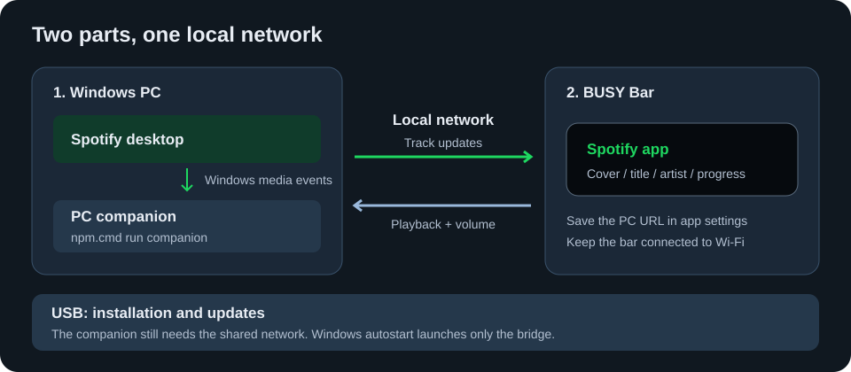
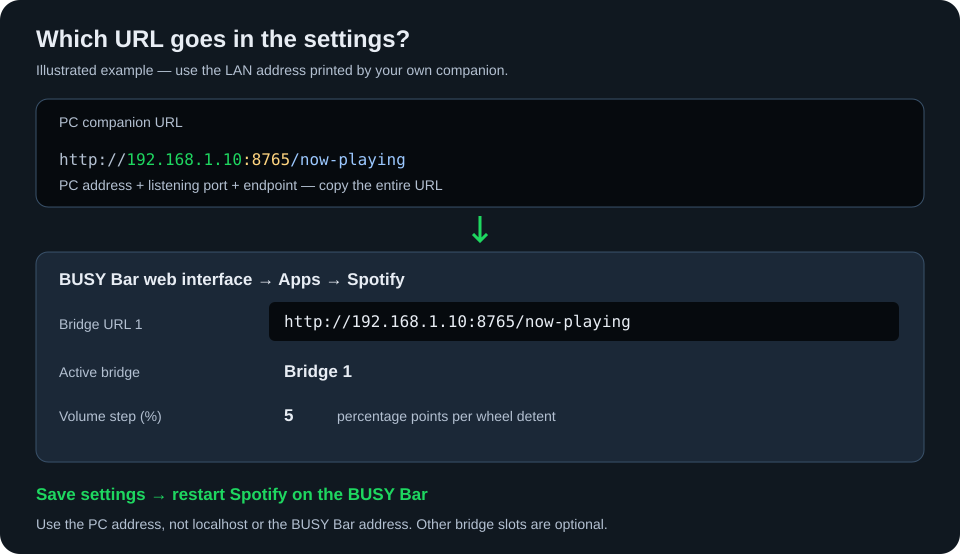

# Spotify for BUSY Bar

Your currently playing Spotify track, album cover and playback controls on the BUSY Bar.

**Windows 10/11 · Free Spotify accounts supported · No Spotify API credentials**

| On the display | From the controls |
| --- | --- |
| Rounded album cover, title and artist | Play / pause and next track |
| Synchronized scrolling for long title and artist lines | Spotify volume from the wheel |
| One-pixel playback progress | Immediate volume percentage overlay |

[Install & configure](#install--configure) · [Controls](#controls) · [Settings](#settings) · [Troubleshooting](#troubleshooting) · [How it works](#how-it-works) · [Developer reference](#developer-reference)

## Before you start

You need **two parts** running: the app on the BUSY Bar and a small companion on your Windows PC.



| Requirement | Details |
| --- | --- |
| Spotify | Windows desktop application, open on the PC. Premium is not required. |
| Windows | Windows 10 or 11; the companion uses your signed-in user's media session. |
| Node.js | Node 24 recommended, matching `.nvmrc`. Supported range: 24–25; Node 26 is excluded. |
| Network | PC and BUSY Bar on the same local network; connect the bar to Wi-Fi. |
| Device installation | USB connection recommended. The manifest requires BUSY Bar API 27.12.0 or later. |
| Source checkout | Git, or an extracted copy of this repository. |

Browser Spotify playback is not supported: Windows identifies it as the browser rather than a reliably distinguishable Spotify session. macOS and Linux companions are not implemented.

## Install & configure

Run the commands below in **PowerShell**, from this repository's folder. `npm.cmd` avoids PowerShell restrictions on `npm.ps1`.

### 1. Prepare the project

If you have not downloaded the repository yet:

```powershell
git clone https://github.com/blooraayy/busybar-spotify.git
cd busybar-spotify
```

Install the locked dependencies:

```powershell
npm.cmd ci
```

### 2. Start the PC companion

```powershell
npm.cmd run companion
```

Keep this terminal open. The companion prints one or more PC addresses. Copy the **LAN URL** for the network shared with the BUSY Bar, for example:

```text
http://192.168.1.10:8765/now-playing
```

Use your PC's actual address, including `/now-playing`. Do not use `localhost` or the BUSY Bar's address. If Windows asks, allow Node.js through the firewall on your **private network**.

Open Spotify desktop and play a song. Opening that URL in a browser on the PC should return a JSON snapshot of the current track.

### 3. Install the device app

Connect the BUSY Bar over USB. In a **second PowerShell terminal**, open the repository folder and run:

```powershell
npm.cmd run build
npm.cmd run app:install
```

The build creates `dist/app.blooraayy.busybar-spotify.tgz`; the install command sends it to the connected bar. USB is used for deployment; the running app still needs the shared local network to reach the companion.

### 4. Save the PC address

Open the BUSY Bar's web interface (Virtual LAN), then **Apps → Spotify**:



| Field | First-time value |
| --- | --- |
| **Bridge URL 1** | The full URL copied in step 2 |
| **Active bridge** | Bridge 1 |
| **Volume step (%)** | Leave at 5, or choose your preferred increment |

Save the settings, then launch Spotify from the BUSY Bar app menu, or run:

```powershell
npm.cmd run app:run
```

**Restart the BUSY Bar app after changing its settings.** The song title, artist and cover should now appear. Progress appears when Windows provides a valid track duration.

### 5. Optional: start the companion with Windows

First stop the manually running companion with **Ctrl+C**, then run:

```powershell
npm.cmd run companion:autostart
Start-ScheduledTask -TaskName "BUSY Bar Spotify Bridge"
```

This registers a hidden task for your Windows user and starts it now. Future sign-ins start **only the bridge**; it never launches Spotify. You no longer need to keep a terminal open.

Keep this checkout and Node.js in their current locations. Rerun the installer if you move either one. The task uses normal user permissions, allows one scheduled instance and retries up to three times on failure.

| Action | PowerShell command |
| --- | --- |
| Inspect the startup task | `Get-ScheduledTask -TaskName "BUSY Bar Spotify Bridge"` |
| Stop this checkout's bridge and reader | `powershell.exe -NoProfile -ExecutionPolicy Bypass -File companion/stop.ps1` |
| Remove automatic startup | `npm.cmd run companion:autostart:remove` |

## Controls

| BUSY Bar input | Action |
| --- | --- |
| **Start**, short press | Pause / resume Spotify |
| Wheel **OK**, short press | Next track |
| Wheel clockwise | Raise Spotify volume |
| Wheel counterclockwise | Lower Spotify volume |
| **Back**, short press | Close the BUSY Bar app |

The wheel changes **Spotify's Windows per-app audio-session volume**. It does not move Spotify's internal volume slider or change the Windows master volume, other apps, or the BUSY Bar speaker volume. If Spotify has no audio session, the command fails without adjusting another app.

## Settings

Change these in **Apps → Spotify** in the BUSY Bar web interface. Save, then restart the device app; no code edits or rebuild are needed.

| Setting | Purpose | Default |
| --- | --- | --- |
| Bridge URL 1 | Full companion URL for the first PC | Empty |
| Bridge URL 2 / 3 | Optional saved URLs for other PCs | Empty |
| Active bridge | Select which one of the three saved URLs to use | Bridge 1 |
| Volume step (%) | Percentage points changed per wheel detent, from 1 to 100 | 5 |

Only the selected bridge is contacted. There is **no automatic switching** to another saved PC when it goes offline. An empty or invalid selected URL shows `Set PC URL`.

The bridge listens on port **8765** by default. `BUSYBAR_SPOTIFY_PORT` overrides it; if changed, also update the saved URL. It exposes current metadata and playback controls without authentication to reachable LAN clients. Use a trusted local network and do not forward this port to the Internet. Spotify credentials are never required, and metadata is not saved to disk.

## Updating an existing installation

After updating your local checkout:

```powershell
npm.cmd ci
npm.cmd run typecheck
npm.cmd run build
npm.cmd run app:install
npm.cmd run app:run
```

If companion files changed, restart the PC bridge too. For a hidden scheduled bridge:

```powershell
powershell.exe -NoProfile -ExecutionPolicy Bypass -File companion/stop.ps1
Start-ScheduledTask -TaskName "BUSY Bar Spotify Bridge"
```

For a terminal-run bridge, stop it with Ctrl+C and run `npm.cmd run companion` again. The stop script matches this checkout's server path and terminates its process tree, avoiding orphaned media readers and occupied ports.

## Troubleshooting

| Symptom | What to check |
| --- | --- |
| `Set PC URL` | Save a full URL ending in `/now-playing` in the selected bridge slot; restart the bar app. |
| `No Wi-Fi` | Connect the BUSY Bar to Wi-Fi and check that it shares the PC's local network. |
| `PC offline` | Check the companion is running, the saved PC address is current, and the private-network firewall allows Node.js on the configured port. |
| `No music` / bridge reports `idle` | Use Spotify desktop in the signed-in Windows session, then pause/resume a song. See media-session diagnostics below. |
| Title remains `Spotify` for some songs | Current fonts cannot render all scripts; see the text limitations below. |
| No progress line | Windows must supply a valid duration. Unknown-duration content hides the line. |
| Settings seem unchanged | Save and restart Spotify on the BUSY Bar, not just the PC companion. |
| Port 8765 is already in use | Avoid running a manual bridge alongside the scheduled one. Stop this checkout's bridge before restarting it. |
| `npm ci` rejects the lockfile | For intentional dependency changes, run `npm.cmd install` and keep `package.json` and `package-lock.json` in sync. |

To inspect media sessions exposed by Windows:

```powershell
powershell.exe -NoProfile -ExecutionPolicy Bypass -File companion/read-media.ps1 -ListSessions
```

If Spotify is absent, enable **Show desktop overlay when using media keys** in Spotify's display settings **if your Spotify version offers it**, then pause/resume playback.

Temporary bridge failures recover automatically. The last confirmed song is preserved initially; a later failure at least 15 seconds after the last successful response shows `PC offline`. Retries back off through 2, 4, 8, 16 and 30 seconds. Confirmed Wi-Fi disconnection shows `No Wi-Fi` and uses a 30-second retry. Recovery does not require relaunching the app.

## How it works

### Windows events and connection lifecycle

The Node.js companion uses a hidden PowerShell adapter for Windows WinRT media APIs. Its process-local execution-policy override does not change the machine policy or install additional packages. `media-events.cs` handles WinRT registration tokens, which PowerShell cannot subscribe to with `Register-ObjectEvent`.

The PC listens for session, metadata, playback-state and timeline events. Notifications are coalesced with an AutoResetEvent, with a coarse 15-second health check for missed events. Title and artist are published before thumbnail decoding; only current state is retained.

The bar keeps **one long poll** to `/now-playing`, using `X-Busybar-Wait: 1`, `X-Busybar-Client` and `If-None-Match`. Changes wake it immediately; quiet requests return an empty HTTP 304 after at most **1.5 seconds**, leaving headroom below the inactivity limit observed on API 27.14.0. Unchanged responses do not decode artwork or redraw the display. Legacy bridges fall back to two-second polling. Event delivery, network and display processing determine latency; there is no fixed latency guarantee.

Controls use a separate serialized request path, so they do not wait behind the subscription. One display queue coalesces pending changes and allows only one display operation in flight. The bridge allows at most four waiting clients and cleans up timers on disconnect, cancellation and shutdown.

Back cancels the subscription through `/playback/cancel-wait`, clears watch, control, overlay, progress and display-retry timers, then releases the input listener after its callback. Already-sent requests may finish. A bounded cancellation cache handles request-arrival races; the app exits when its last pending handle is released.

### Album cover, text and icons

The cover occupies the left **16 × 16 pixels**, with rounded corners. Windows crops and resizes artwork on the PC; the companion converts it to XPM2 with at most 32 colors and less than 1 KiB of data. The bar never decodes full artwork. Only the current thumbnail is cached in memory, unchanged covers are not redrawn, and missing artwork clears the cover.

Title and artist use the remaining 54 pixels after a two-pixel gap. The title's visible ink occupies rows 1–7, the artist rows 9–13, and progress row 15: rows 8 and 14 provide one-pixel separation, including letter descenders.

**Text limitation:** current bitmap fonts use ASCII. Latin accents are transliterated; unsupported characters become spaces, so some non-Latin titles can fall back to `Spotify`. General Unicode/Japanese rendering is not included in this branch. Paused playback shows `Paused`; an absent Spotify session shows `No music`.

The packaged front icon is an 8 × 8 green Spotify mark; the back icon is 11 × 11 grayscale. Their waves are aligned to the pixel grid for legibility, with no runtime downloads.

### Synchronized scrolling

When both title and artist exceed their viewports, `src/scroll-sync.js` measures them with `textWidth` and matches their native circular-scroll cycles. Both move at **1200 pixels/minute** after a **1500 ms** initial delay. The shorter line waits for the longer one before the next cycle starts.

Traversal time includes firmware 1.3.1's three-space gap. Each repeat pause is 2500 ms plus the difference between that line's traversal and the longest traversal. Metadata changes clear and recreate the pair in one serialized draw to reset old LVGL animation phases. Cover-only and progress changes do not reset scrolling. When either line fits, normal pauses remain.

Animation runs in firmware, without per-frame requests or JavaScript scroll timers. Recheck the traversal formula if firmware circular-scroll behavior changes.

### Playback controls and volume feedback

| Companion route | Windows operation |
| --- | --- |
| `POST /playback/toggle` | `TryTogglePlayPauseAsync` |
| `POST /playback/next` | `TrySkipNextAsync` |
| `POST /playback/volume?steps=<n>` | Core Audio volume for sessions owned by Spotify.exe |

Control requests require `X-Busybar-Control: 1`; browser-origin requests are rejected. These checks are not authentication. Next and play/pause share one pending slot; presses during an active command are ignored. Failed commands are never automatically retried, avoiding duplicated actions.

The first wheel turn is sent immediately. Further turns are combined at most once every 100 ms, with a maximum of 10 pending steps; opposite turns cancel. Controls remain serialized and Back discards unsent changes. A persistent PC volume worker compiles `volume.cs` once at startup, blocks while idle and never launches Spotify. Values are clamped to 0–100% without changing the mute switch.

A zero-step request reads the initial volume. Each wheel turn immediately previews the configured percentage locally, independent of network replies. Older replies cannot rewind the preview; the latest confirmation reconciles it with the actual level. A failed control hides the preview and discards its baseline.

The overlay uses six persistent canvas elements: background, gradient fill, percentage, arrows and speaker. Normal changes update only fill width and value; icon/arrow states change at 0/100. Borders are disabled, and zero uses a one-pixel black fill because zero-width rectangles are not accepted. Pending previews coalesce to the latest value. Track/progress drawing waits until the overlay disappears after 1.5 seconds.

Drawing uses the supported local HTTP canvas API rather than the internal LVGL slider used by native Settings. The app keeps its default 128 KiB heap. The design follows the firmware's read-only [Sound settings slider](https://github.com/busy-app/busybar-firmware/blob/dev/applications/settings/sound_settings/widgets/slider_view.c) and [speaker assets](https://github.com/busy-app/busybar-firmware/tree/dev/assets/images/external/sound_settings). Older full-image resources remain for reference but are not used by the active overlay; `node tools/generate-volume-images.mjs` regenerates them.

### Track progress

The elapsed portion is a one-pixel green gradient with a pale playhead, with no visible border or unplayed rail. It spans x=19–70, backed by black at x=18–71, y=15. At zero progress the line is black.

Windows SMTC supplies timeline anchors. `TimelinePropertiesChanged` updates the current anchor, but ordinary clock ticks do not wake the bar. Playback/duration changes and seeks of at least 1.5 seconds do. Snapshots contain `position_ms` and `duration_ms`, adjusted on the PC to avoid differences between PC and device clocks.

Between events, the bar estimates progress locally and schedules only the **next visible pixel boundary**, at least one second apart. There is no per-second network polling. Paused or finished tracks have no progress timer. Three stable element IDs share the display queue; the volume overlay takes priority. Unknown duration, idle/error states and confirmed disconnection clear the line. A transient bridge failure freezes it until recovery; Back clears its timer.

## Developer reference

### Project layout

`src/` is the app — everything in it is yours to edit.

The entry point is `src/main.js`. The name is fixed: the build turns it into `scripts/main.js`, the file the BUSY Bar starts. Any imported modules are emitted as separate files alongside it in `scripts/`, unless `npm run build -- --bundle` inlines them.

`src/main.js` is run from top to bottom, not imported: it starts the app by calling `main()` at the end and must not export anything. Imported modules can use standard exports.

```
busybar-spotify/
├── src/                          the app
│   ├── main.js                   the entry point: function main(), called at the end
│   ├── appmeta/
│   │   ├── manifest.json         id, name, version, api_version
│   │   ├── settings.json         the settings screen — optional
│   │   ├── icon_front_8x8.png    front icon, 8×8 color — optional
│   │   └── icon_back_11x11.png   back icon, 11×11 grayscale — optional
│   ├── images/
│   ├── animations/
│   └── sounds/
├── shared/                       app-level helpers, imported as @shared/*
```

Both icons are optional; without them a default is used. The current icons are based on the [official Spotify icon asset](https://developer.spotify.com/images/guidelines/design/2024-spotify-logo-icon.zip).

### Resources

Anything in `src/` that isn't a source file is copied into the package, sorted by what the BUSY Bar can read:

| Extension | Destination |
| --- | --- |
| `.png` `.image` | `images/` |
| `.anim` | `animations/` |
| `.snd` | `sounds/` |
| anything else | `resources/` |

A file in `src/images`, `src/animations` or `src/sounds` keeps its folder as long as the BUSY Bar reads its format.

`images/`, `animations/` and `sounds/` hold only those formats. An image, animation or sound in another format — `.jpg`, `.gif`, `.svg`, `.wav`, `.mp3` and the like — goes to `resources/`, and the build warns that the device cannot read it.

Everything the app draws goes through the layout helpers in `@busy-app/busy-lib`: build a tree out of `row` / `column` / `stack`, hand it to `render()`, and send the result with `device.DisplayDraw()`. The screen is 72×16 pixels.

### Input

`listen("input", handler)` delivers the device keys: `ok`, `start` and `back` with a `press` / `release` / `short` / `long` / `repeat` action, and `encoder` with a `delta` of `1` or `-1`. It returns an unbind function.

Use `short` as the default action for a button press: it fires once, after a normal press and release. `press` fires immediately on key down and is followed by `short`, so handling `press` as a tap can react twice. Use `long` and `repeat` for hold gestures.

### Commands

| Command | Description |
| --- | --- |
| `npm run build` | empties `dist/` and builds the package into `dist/app.blooraayy.busybar-spotify.tgz` |
| `npm run build -- --emit dir` | leaves the `app.blooraayy.busybar-spotify/` folder instead of the `.tgz` |
| `npm run build -- --emit both` | leaves the folder and the `.tgz` |
| `npm run build -- --out <path>` | builds into `<path>` instead, replacing only this app's package there |
| `npm run build -- --tgz-name <name>` | names the `.tgz`, e.g. `"{id}-{version}.tgz"` |
| `npm run build -- --no-minify` | readable output, for debugging |
| `npm run build -- --bundle` | inlines every module into one `main.js` |
| `npm run build -- --addr <host>` | sets the BUSY Bar address the app connects to, `localhost` by default |
| `npm run typecheck` | checks JavaScript using JSDoc (no TypeScript app sources) |
| `npm run app:install` | installs `dist/app.blooraayy.busybar-spotify.tgz` on the BUSY Bar; build it first with `npm run build` |
| `npm run app:uninstall` | removes the app from the BUSY Bar, keeping its settings |
| `npm run app:run` | launches the installed app |
| `npm run app:stop` | quits the running app |

The four `app:` commands talk to the BUSY Bar connected over USB. For a device connected over Wi-Fi, pass `--addr <host>` with its network IP address or hostname, and `--password <password>` if password protection is enabled:

```sh
npm run app:install -- --addr <host>
npm run app:install -- --addr <host> --password <password>
```

### Build output

The package folder is named after the app id:

```
dist/
└── app.blooraayy.busybar-spotify/
    ├── appmeta/manifest.json
    ├── scripts/main.js
    └── images/ animations/ sounds/ resources/
```

By default the build packs that folder into `dist/app.blooraayy.busybar-spotify.tgz`, with the folder itself at the root of the archive, and removes the folder; `--emit dir` keeps only the folder, `--emit both` keeps both. `--tgz-name` gives the archive another name; `{id}` and `{version}` in it are replaced with the manifest values.

### Releasing

Pushing a git tag matching the manifest `version` (e.g. `0.1.0`) builds the app and attaches `app.blooraayy.busybar-spotify-<version>.tgz` to a GitHub release. The release notes open with the app's name, id, version and API version. The release fails when the tag differs from the manifest `version`.

### Manifest

`src/appmeta/manifest.json` carries the app's identity and a couple of knobs (see the [apps documentation](https://github.com/busy-app/busybar-firmware/blob/dev/documentation/JavaScript%20Applications.dox.md)):

| Field | Description |
| --- | --- |
| `format_version` | manifest format, `1` — required |
| `id` | up to 32 characters — required |
| `name` | display name — required |
| `version` | semver, e.g. `1.0.0` — required |
| `api_version` | minimum BUSY Bar HTTP API version the app needs, e.g. `27.12.0` — required |
| `description`, `author` | free form, default `""` |
| `heap_size_kib` | memory for the app heap, 1–512, default 128 |
| `debug` | when true, shown only in developer mode, default false |

Keep the default 128 KiB heap unless measurements show more is necessary; reduce allocations first.

### Node version

The app builds on Node 24 — the version in `.nvmrc` and the range `engines` allows. Node 26 breaks the build and is excluded. With `fnm` or `nvm` installed, `fnm use` / `nvm use` picks the right one up from `.nvmrc`.

### Settings implementation

To give the app a settings screen, add `src/appmeta/settings.json` describing the fields, then read the stored values:

```js
import { loadValues } from "@shared/settings";

const values = await loadValues();
```

`loadValues()` returns `null` when nothing is stored yet — use the defaults.

### JavaScript development on Windows

Use `npm.cmd` in PowerShell if the execution policy blocks `npm.ps1`:

```powershell
npm.cmd ci
npm.cmd run typecheck
npm.cmd run build
```

App and shared helper sources are plain `.js`. `jsconfig.json` enables JavaScript
checking and the `@shared/*` alias. `tsconfig.json` extends it because the build
tool reads aliases from that filename. TypeScript is a development checker only;
`types/env.d.ts` describes firmware globals and is not executable app code.

The app displays Spotify track metadata from the Windows companion. A short Back
press cancels the subscription, clears timers and exits. A short Start press toggles Spotify playback through the Windows companion.

CLI 0.6.0 generates Windows font-map imports with backslashes. The version is pinned
and `tools/patch-busy-cli.mjs` applies an idempotent fix after install and before
build. This changes only the local build tool, not firmware. Review/remove the
workaround when upgrading the CLI. Commit `package-lock.json`; do not commit
`node_modules/` or `dist/`.
